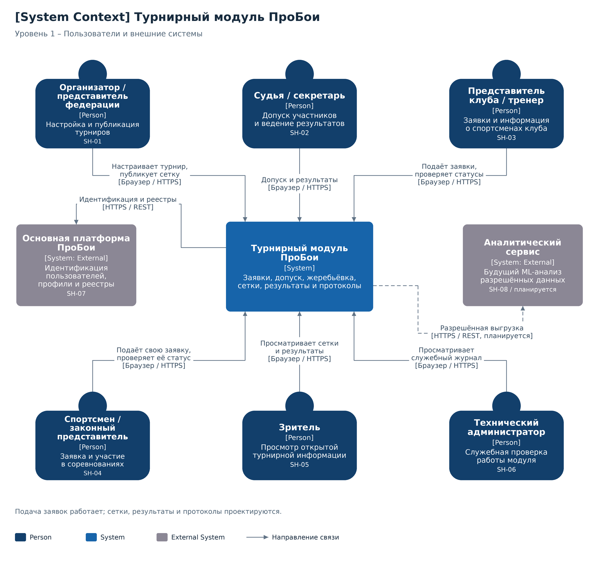
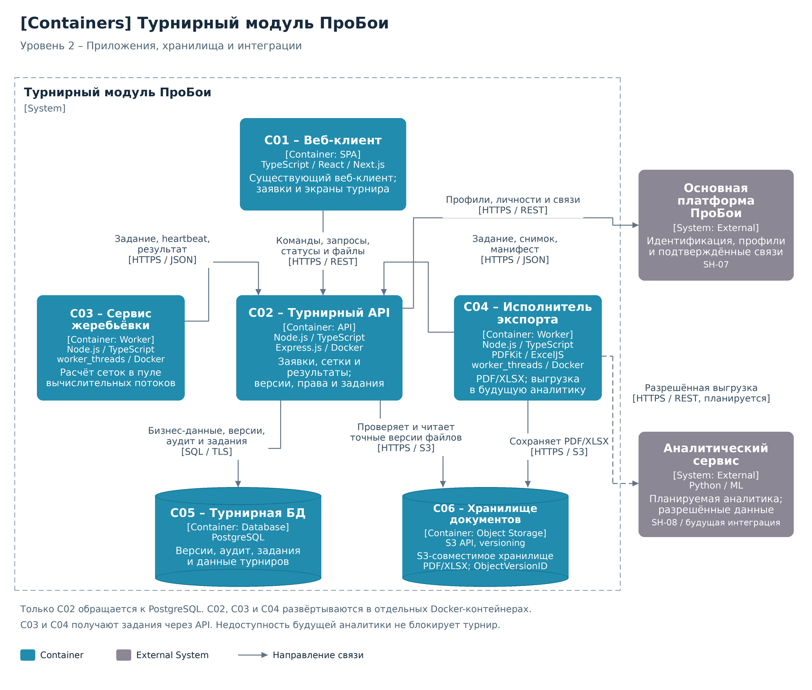
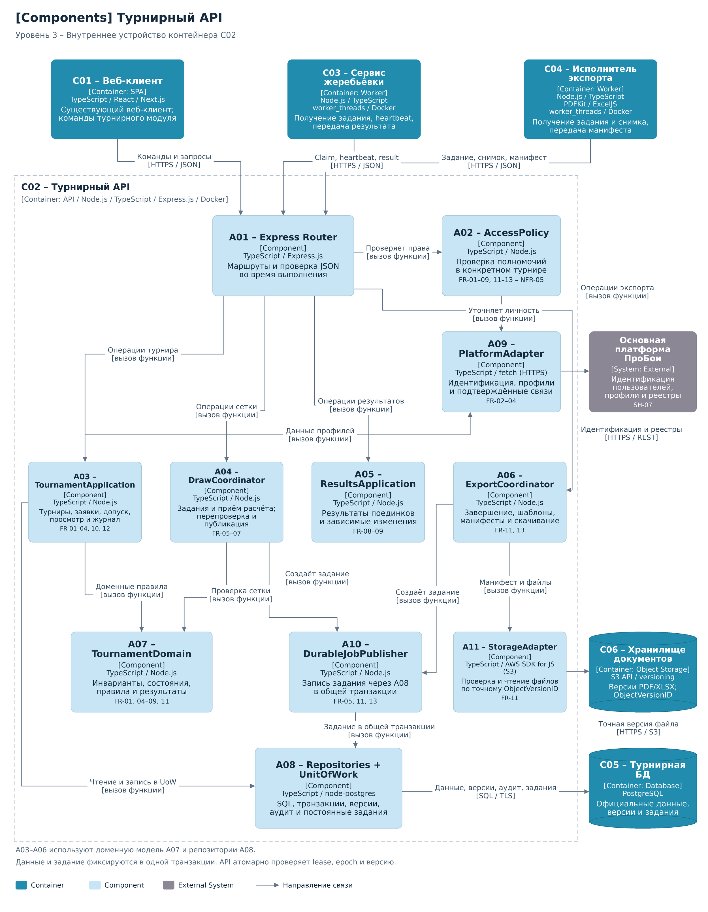
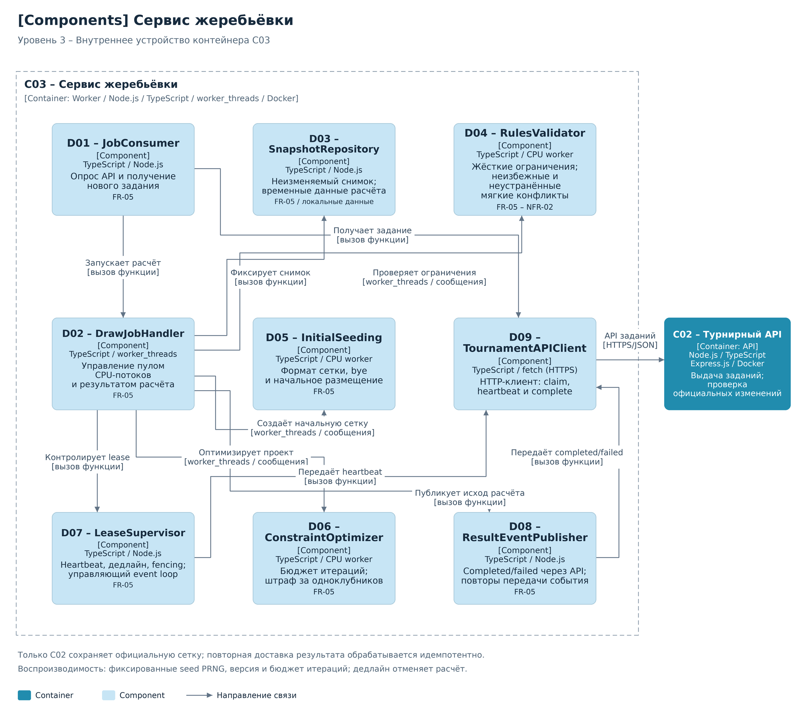

# Лабораторная работа №2

## Использование C4 model для проектирования архитектуры программной системы

| Поле | Значение |
|---|---|
| Студент | Козлов Артём |
| Группа | РИС-23-4 |
| Вариант | Индивидуальная тема ВКР, турнирный модуль ПроБои |
| Тема ВКР | Разработка турнирного модуля для автоматизации проведения спортивных мероприятий по единоборствам |
| Ссылка на ЛР №1 | [Требования к системе](../../Lab%20Work%20%E2%84%961/docs/README.md) |
| Репозиторий | [GitHub](https://github.com/Artem1441/software-architecture-design-labs) |
| Инструмент диаграмм | [draw.io, исходник схем](../src/c4.drawio), изображения PNG |
| Дата выполнения | 25 11 2026 |

**Тема:** использование нотации C4 model для проектирования архитектуры программной системы.

**Цель:** получить опыт использования графической нотации для фиксации архитектурных решений.

## Краткое описание системы

На платформе ПроБои уже реализована подача заявок на соревнования. В этой работе проектируется следующий этап турнирного модуля: жеребьёвка, корректировка и публикация сеток, проведение поединков, фиксация результатов и выпуск протоколов. Существующие заявки входят в общую модель турнира и используются как исходные данные для допуска и жеребьёвки. Отдельная ML-аналитика на Python относится к будущему этапу и пока не реализована.

Серверная часть развивается на **Node.js, TypeScript и Express.js**, данные хранятся в **PostgreSQL** и **S3-совместимом хранилище**, приложения развёртываются с **Docker**. Диаграммы показывают целевое устройство модуля: существующие функции заявок и проектируемые функции проведения турнира.

### Требования, влияющие на архитектуру

| ID из ЛР №1 | Требование | Архитектурное решение |
|---|---|---|
| **NFR-01** | Жеребьёвка до 10 000 участников за время не более 300 секунд от принятия задания до сохранения проверенного проекта. | Отдельный вычислительный исполнитель, сохраняемые задания и общий срок выполнения. |
| **NFR-02** | Качество распределения не ниже 95% в среднем на 100 тестовых турнирах; нарушений обязательных ограничений – 0. | Проверка входа и результата, воспроизводимый алгоритм, повторная проверка в API. |
| **NFR-03** | Полный пакет PDF и Excel готов не позднее 5 секунд после фиксации завершения турнира. | Отдельный исполнитель экспорта и зарезервированные ресурсы для протоколов. |
| **NFR-04** | Среднее время отображения обновлённой таблицы не более 2 секунд при 200 одновременно работающих пользователях. | Изоляция тяжёлых операций от HTTP API, получение таблицы по категории, раунду и версии. |
| **NFR-05** | Ни одной успешной несанкционированной операции в проверочной матрице и ни одного служебного поля в публичных ответах. | Проверка полномочий на конкретный турнир, отдельные публичные представления и закрытые документы. |

## Оглавление

1. [Диаграмма системного контекста](#1-диаграмма-системного-контекста)
2. [Диаграмма контейнеров](#2-диаграмма-контейнеров)
3. [Компоненты турнирного API](#3-компоненты-турнирного-api)
4. [Компоненты сервиса жеребьёвки](#4-компоненты-сервиса-жеребьёвки)

## 1. Диаграмма системного контекста

На уровне C4-L1 турнирный модуль представлен одной системой. Вокруг него показаны шесть человеческих ролей из первой лабораторной, основная платформа ПроБои и будущая аналитическая подсистема. Внутренние приложения и хранилища раскрываются на следующем уровне.

### Описание элементов

| Элемент | Тип | Назначение |
|---|---|---|
| Турнирный модуль ПроБои | System | Связывает заявки и допуск с сетками, поединками, результатами и протоколами. |
| **SH-01 Организатор / представитель федерации** | Person | Настраивает турнир, запускает разрешённые операции подготовки, публикует сетки и получает документы. |
| **SH-02 Судья / секретарь** | Person | Проверяет допуск, работает с сетками и результатами в пределах назначения на турнир. Права судьи и секретаря различаются. |
| **SH-03 Представитель клуба / тренер** | Person | Подаёт заявки своих спортсменов, проверяет их статусы, просматривает сетки и результаты. |
| **SH-04 Спортсмен / законный представитель** | Person | Подаёт доступную ему заявку и получает сведения о допуске и участии. Связь представительства проверяется. |
| **SH-05 Зритель** | Person | Просматривает опубликованные сетки и подтверждённые результаты. |
| **SH-06 Технический администратор** | Person | Использует служебный журнал для разбора инцидентов. Техническая роль не даёт судейских полномочий. |
| **SH-07 Основная платформа ПроБои** | External System | Предоставляет идентификацию, единые профили, реестры клубов и подтверждённые связи. |
| **SH-08 ML-аналитика, планируется** | External System | Будущий получатель разрешённых турнирных данных для анализа. Соответствует необязательной интеграции FR-13. |

### Внешние интеграции

| Внешняя система | Протокол | Назначение |
|---|---|---|
| Основная платформа ПроБои | HTTPS / REST | Проверка идентичности и получение профилей, реестров и связей. Сохраняются единые `athlete_id` и внутренние `club_id`. |
| Будущая ML-аналитика | HTTPS / REST, JSON | Передача разрешённой выгрузки с идентификатором турнира и версией данных. Интеграция подключается после реализации основных турнирных функций. |

Граница системы проходит вокруг турнирного модуля. Поэтому основная платформа является внешней зависимостью, хотя принадлежит тому же продукту. Подача заявок остаётся существующей функцией модуля; сервис жеребьёвки входит в его проектируемую серверную часть.

## 2. Диаграмма контейнеров

На уровне C4-L2 выделены шесть контейнеров: веб-клиент, основной API, два фоновых исполнителя и два хранилища. C02, C03 и C04 запускаются как отдельные серверные приложения. Основной API развивается на базе существующего backend ПроБои.

### Описание контейнеров

| Контейнер | Тип | Технология | Назначение | Какие FR покрывает |
|---|---|---|---|---|
| **C01 Веб-клиент** | Container: SPA | TypeScript, React / Next.js, статический клиент | Существующие формы заявок и новые экраны сеток, результатов, статусов расчёта и документов. | Пользовательские сценарии FR-01–FR-13. |
| **C02 Турнирный API** | Container: API | Node.js, TypeScript, Express.js, Docker | Заявки, допуск, версии сеток, результаты, права, аудит, задания и метаданные документов. Единственный владелец турнирных таблиц PostgreSQL. | FR-01–FR-13. |
| **C03 Сервис жеребьёвки** | Container: Worker | Node.js, TypeScript, worker_threads, Docker | Построение и оптимизация проекта сетки по зафиксированному составу и регламенту. | FR-05; NFR-01, NFR-02. |
| **C04 Исполнитель экспорта** | Container: Worker | Node.js, TypeScript, PDFKit, ExcelJS, worker_threads, Docker | Создание PDF и XLSX, загрузка файлов в S3; в дальнейшем – отправка разрешённых выгрузок в ML-аналитику. | FR-11, FR-13. |
| **C05 Турнирная БД** | Container: Database | PostgreSQL | Заявки, допуск, сетки, результаты, версии, права, аудит, снимки данных, очередь заданий и описания пакетов. | Хранение и целостность данных FR-01–FR-13. |
| **C06 Хранилище документов** | Container: Object Storage | S3-совместимое хранилище, S3 API, версионирование объектов | Закрытое хранение PDF и XLSX. В описании пакета фиксируются ключи и конкретные версии файлов. | FR-11. |

Для работы с PostgreSQL выбран `node-postgres`, для S3 – AWS SDK for JavaScript. Применение этого SDK не фиксирует поставщика хранилища: используется согласованный S3-совместимый endpoint. Версионирование объектов является требованием к бакету с протоколами.

Python предусмотрен только для будущей внешней ML-подсистемы SH-08. Жеребьёвка C03 использует алгоритм проверки и оптимизации ограничений на TypeScript, обучение модели для её выполнения не требуется.

### Связи между контейнерами

Стрелки показывают инициатора обращения. Ответ на запрос относится к тому же взаимодействию.

| Откуда | Куда | Протокол | Назначение |
|---|---|---|---|
| C01 | C02 | HTTPS / REST, JSON | Команды пользователя, запросы сеток и статусов, скачивание разрешённых документов. |
| C02 | C05 | PostgreSQL protocol / SQL поверх TLS | Чтение и транзакционное изменение турнирных данных, аудита и заданий. |
| C03 | C02 | HTTPS / JSON | Получение задания, продление аренды, передача проекта сетки или ошибки. |
| C04 | C02 | HTTPS / JSON | Получение экспортного задания и снимка данных, продление аренды, передача описания готового пакета. |
| C04 | C06 | HTTPS / S3 API | Загрузка PDF и XLSX в закрытый бакет. |
| C02 | C06 | HTTPS / S3 API | Проверка состава пакета и чтение конкретной версии файла для выдачи пользователю. |
| C02 | SH-07 | HTTPS / REST | Проверка идентичности, профили, реестры и подтверждённые связи. |
| C04 | SH-08 | HTTPS / REST, JSON | Будущая необязательная передача разрешённых данных для ML-анализа. |

Браузер и фоновые исполнители работают с турнирными данными через C02. Доступ к PostgreSQL предоставляется только основному API. Учётные данные исполнителя позволяют работать с назначенными заданиями, но не подтверждать спортивные результаты от имени судьи.

### Выбор архитектурного стиля

Выбрана **клиент-серверная сервисная архитектура**: основной API и два отдельно развёртываемых исполнителя, со слоистой организацией кода внутри API. API расширяет существующую обработку заявок, а выделение расчётов и экспорта позволяет распределять ресурсы для NFR-01, NFR-03 и NFR-04. Общий владелец турнирных данных сохраняет согласованность сеток, результатов и аудита по NFR-02 и проверяет права по NFR-05. Выполнение всех операций в одном процессе отклонено из-за конкуренции за процессорное время; разделение каждой предметной функции в отдельный микросервис отклонено из-за усложнения транзакций и эксплуатации. Для текущего объёма проекта выбраны сохраняемые задания в PostgreSQL без отдельного брокера; дополнительные HTTP-взаимодействия требуют обработки повторов, сроков и отказов.

### Выполнение жеребьёвки

1. Пользователь запускает расчёт выбранной категории в C01.
2. C02 проверяет полномочия и состояние категории, фиксирует состав, клубы, рейтинги, регламент и `seed`.
3. Задание, снимок входа, версия и аудит сохраняются одной транзакцией. Браузер получает `202 Accepted` и идентификатор операции.
4. C03 запрашивает задание через служебный API и получает его в аренду на ограниченный срок. Расчёт выполняется между короткими HTTP-запросами.
5. Исполнитель строит проект, проверяет его и отправляет результат с идентификатором задания, номером попытки, хешем входа и версией алгоритма.
6. C02 повторно проверяет обязательные ограничения. В завершающей транзакции он проверяет состояние задания, владельца, номер и срок аренды, общий срок и актуальность входной версии.
7. Новая версия проекта, завершение задания и аудит сохраняются одним коммитом. Публикация выполняется отдельным действием FR-07.

Очередь заданий хранится в PostgreSQL. Выдача задания выполняется в короткой транзакции с блокировкой выбранной строки; блокировка не удерживается на время расчёта. После выдачи в БД сохраняются исполнитель, срок аренды и её номер. Исполнитель периодически продлевает аренду через `heartbeat`.

Предел 300 секунд включает очередь, расчёт, передачу, повторную проверку и сохранение. Повторная попытка не обнуляет общий срок. При расчёте нескольких категорий координатор учитывает общий срок всего заказанного набора сеток.

### Формирование протоколов

При завершении турнира C02 в одной транзакции сохраняет итоговое состояние, снимок подтверждённых данных, аудит и задание на полный пакет документов. C04 создаёт предусмотренные протоколы в PDF и XLSX и загружает их в S3. Для документов резервируются вычислительные слоты, которые не используются аналитическими выгрузками; шаблоны и шрифты подготовлены заранее.

Исполнитель передаёт в API описание пакета: состав файлов, ключи, `VersionID` и контрольные суммы. API проверяет комплектность и конкретные версии объектов, затем в короткой транзакции повторно проверяет задание, аренду и версию турнирных данных и фиксирует готовность пакета. Пока проверка не завершена, пакет недоступен для скачивания.

Ключ объекта включает задание, попытку и версию данных либо хеш содержимого. Дополнительно в S3 включается версионирование: чтение выполняется по принятому `VersionID`, поэтому повторная запись под тем же ключом не подменяет уже принятый файл. Исполнителям не предоставляется право удалять принятые версии. Пакет исторической версии хранится отдельно и не становится текущим, если турнир уже изменился.

Пять секунд по NFR-03 отсчитываются от фиксации завершения турнира до готовности всех файлов, включая очередь, генерацию, загрузку и фиксацию пакета. Достижение этого порога проверяется нагрузочными испытаниями на размерах турниров из ЛР №1.

### Развёртывание

API, сервис жеребьёвки и исполнитель экспорта имеют отдельные Docker-образы и запускаются независимо. Для разработки и испытаний состав приложений и PostgreSQL можно поднять через Docker Compose. S3 подключается по endpoint с отдельными учётными данными; его данные не привязаны к файловой системе контейнера API.

Число экземпляров исполнителей и размеры пулов ограничиваются ресурсами стенда. Увеличение их числа не устраняет общую зависимость от API и PostgreSQL. При недоступности ML-аналитики турнир продолжается; ошибка относится только к её отдельной выгрузке.

## 3. Компоненты турнирного API

На уровне C4-L3 раскрывается контейнер C02. Он содержит 11 компонентов, которые обрабатывают запросы, применяют правила турнира, сохраняют изменения и координируют фоновые операции. Соседние приложения, хранилища и основная платформа показаны за границей API.

### Описание компонентов

| Компонент | Роль и ответственность | Технология | Покрываемые FR |
|---|---|---|---|
| **A01 Express Router** | API Layer. Принимает пользовательские и служебные запросы, проверяет структуру JSON во время выполнения, вызывает прикладной сценарий и формирует ответ. | TypeScript, Express.js | Входная точка FR-01–FR-13. |
| **A02 AccessPolicy** | Проверка пользователя, роли, действия и доступа к конкретному турниру. Отдельная проверка служебных исполнителей. | TypeScript | FR-01–FR-09, FR-11–FR-13; NFR-05. |
| **A03 TournamentApplication** | Application. Работа с конфигурацией, существующими заявками, статусами и допуском; чтение опубликованной таблицы и журнала. | TypeScript | FR-01–FR-04, FR-10, FR-12. |
| **A04 DrawCoordinator** | Application. Фиксация состава, выдача заданий, приём проекта, ручная корректировка, утверждение и публикация сетки. | TypeScript | FR-05–FR-07. |
| **A05 ResultsApplication** | Application. Подтверждение и исправление исходов с проверкой версии и зависимых поединков. | TypeScript | FR-08, FR-09. |
| **A06 ExportCoordinator** | Application. Завершение турнира, создание экспортных заданий, проверка готового пакета, повторное формирование и скачивание. | TypeScript | FR-11, FR-13. |
| **A07 TournamentDomain** | Domain. Категории, допуск, состояния турнира, целостность сетки, допустимые исходы и последствия изменения результата. | TypeScript | FR-01, FR-04–FR-09; условия завершения для FR-11. |
| **A08 Repositories + UnitOfWork** | Repositories. Чтение данных и согласованное сохранение версии, результата, зависимостей, аудита и заданий. | TypeScript, node-postgres | Сохранение и целостность данных FR-01–FR-13. |
| **A09 PlatformAdapter** | Integration. Проверка идентичности, получение профилей, реестров и подтверждённых связей из основной платформы. | TypeScript, HTTP client / fetch | FR-02–FR-04, поддержка A02. |
| **A10 DurableJobPublisher** | Events / Publisher. Сохраняет задания и исходящие события через A08 внутри текущей транзакции. | TypeScript | FR-05, FR-11, FR-13. |
| **A11 StorageAdapter** | Integration. Проверка состава пакета и чтение закрытых объектов по точным версиям после проверки прав. | TypeScript, AWS SDK for JavaScript / S3 | FR-11. |

Все компоненты работают в приложении Node.js. Внутренние связи обозначают вызовы кода; для внешних связей указаны HTTPS или SQL. Прикладные компоненты A03–A06 используют общий доменный слой A07 и репозитории A08; повторяющиеся зависимости сокращены на схеме.

### Подтверждение и исправление результата

A01 принимает команду, A02 проверяет полномочия, A05 организует сценарий, A07 проверяет спортивные правила. Через A08 одной транзакцией сохраняются результат, изменения следующих поединков или круговой таблицы, новая версия и аудит. В UnitOfWork все SQL-запросы этой транзакции выполняются на одном выделенном соединении `node-postgres`.

При исправлении проверяется ожидаемая версия данных. Если зависимый поединок уже начался или завершён, автоматическое изменение блокируется согласно FR-09. Повтор принятого запроса возвращает прежнее подтверждение без повторного продвижения спортсмена.

### Задания и доступ

A10 добавляет задание до общего коммита изменения турнира. Поэтому завершение турнира и необходимость сформировать документы фиксируются вместе. A10 является компонентом API; отдельный брокер сообщений в этой модели не используется.

A01 проверяет входные данные при выполнении запроса, включая обязательные поля и допустимые значения. Публичные ответы формируются по разрешённому набору полей. Контакты, документы, фактический вес и данные представителей остаются служебными. Скачивание проходит через A06 и A11 после проверки прав в A02.

## 4. Компоненты сервиса жеребьёвки

Вторая диаграмма C4-L3 раскрывает контейнер C03. Он содержит 9 компонентов. Входным адаптером служит потребитель заданий, поскольку сервис получает работу от API и не обслуживает пользовательские запросы напрямую.

### Описание компонентов

| Компонент | Роль и ответственность | Технология | Покрываемые FR |
|---|---|---|---|
| **D01 JobConsumer** | Входной адаптер. Получает разрешённое задание через API при наличии свободного вычислительного слота. | Node.js, TypeScript | FR-05. |
| **D02 DrawJobHandler** | Application. Организует этапы обработки, передаёт вычисление в пул потоков и собирает результат. | TypeScript, worker_threads | FR-05. |
| **D03 SnapshotRepository** | Repository. Хранит временный неизменяемый снимок входа и рабочий проект текущего задания в памяти. | TypeScript | FR-05. |
| **D04 RulesValidator** | Domain. Проверяет допуск, категории, уникальность участников и структуру до и после расчёта. | TypeScript | FR-05; NFR-02. |
| **D05 InitialSeeding** | Domain. Создаёт олимпийскую или круговую структуру, свободные места и начальный посев по регламенту. | TypeScript | FR-05. |
| **D06 ConstraintOptimizer** | Domain. Выполняет допустимые перестановки для улучшения мягких критериев, сохраняя обязательные ограничения. | TypeScript | FR-05; NFR-01, NFR-02. |
| **D07 LeaseSupervisor** | Контроль выполнения. Продлевает аренду, проверяет общий срок и прекращает работу при утрате права на попытку. | Node.js, TypeScript | FR-05. |
| **D08 ResultEventPublisher** | Events / Publisher. Передаёт завершение или ошибку через D09 с идентификатором задания и версии, обрабатывает повтор отправки. | TypeScript | FR-05. |
| **D09 TournamentAPIClient** | Integration. Выполняет короткие запросы получения задания, продления аренды и передачи результата в C02. | TypeScript, HTTP client / fetch | FR-05. |

### Вычисление и контроль срока

D02 передаёт вычислительную часть D04–D06 в ограниченный пул `worker_threads`. Между управляющим кодом и рабочими потоками передаются сообщения с данными и результатом. D07 остаётся в управляющем цикле событий и продлевает аренду, пока рабочий поток рассчитывает сетку. Такой же принцип применяется в C04 к тяжёлой подготовке PDF и XLSX.

D03 хранит только временные данные задания. После перезапуска снимок повторно запрашивается у C02; собственной постоянной БД у сервиса жеребьёвки нет. Сохранение официального проекта и публикация выполняются основным API.

### Корректность и воспроизводимость

D04 проверяет вход, D05 создаёт начальную структуру, D06 улучшает распределение, затем D04 повторно проверяет результат. C02 независимо проверяет обязательные ограничения перед принятием проекта. Если эта перепроверка становится вычислительно тяжёлой, она выполняется во внутреннем ограниченном пуле потоков API до завершающей транзакции.

Для повторения расчёта сохраняются входной снимок, версия регламента и алгоритма, `seed`, бюджет итераций и порядок разрешения равных вариантов. Используется генератор псевдослучайных чисел с явно задаваемым начальным состоянием. Истечение общего срока означает ошибку выполнения, а не принятие случайного промежуточного результата.

Обязательные ограничения не допускают нарушений. Оставшаяся встреча одноклубников отмечается как доказуемо вынужденная только при наличии обоснования; в остальных случаях это неустранённый мягкий конфликт. Оценка качества выполняется по методике NFR-02 из первой лабораторной.

### Обработка отказов

| Ситуация | Поведение системы |
|---|---|
| Исполнитель остановился | После истечения аренды API разрешает новую попытку в пределах общего срока. |
| Старый исполнитель вернул результат после выдачи новой попытки | API отклоняет его по устаревшему номеру аренды. |
| Ответ на принятие результата потерялся | Повтор с тем же идентификатором и содержимым возвращает ранее сохранённое подтверждение. |
| Под тем же идентификатором пришёл другой результат | API отклоняет конфликтующий запрос. |
| Во время расчёта изменились состав или регламент | Проект не применяется к новой версии; требуется повторный расчёт по актуальному снимку. |
| Общий срок истёк | Задание завершается ошибкой срока и не считается выполнением NFR-01. |

Повторное вычисление допустимо, но принятый результат изменяет турнир только один раз. Изменения и их причины сохраняются в журнале.
